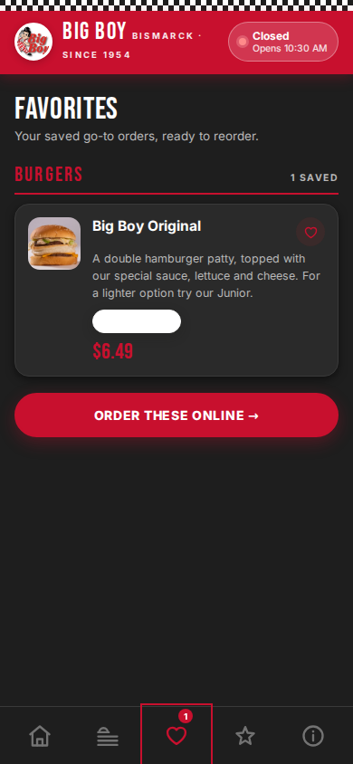
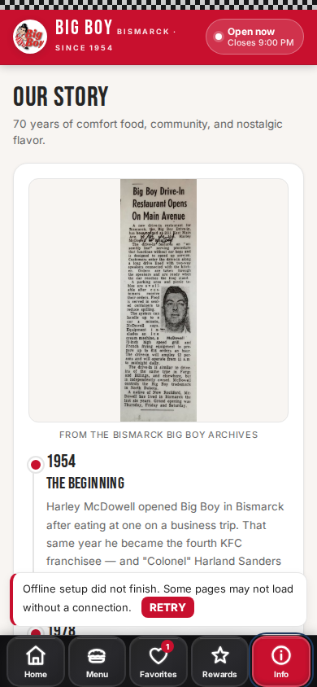

# Bismarck Big Boy — Mobile Web App

[](https://github.com/MidnightRaven9/bismarck-big-boy-app/blob/main/LICENSE)
[](https://html.spec.org/)
[](https://opencode.ai)
[](https://midnightraven9.github.io/bismarck-big-boy-app/)

A customer-facing mobile web app for [Bismarck Big Boy](https://www.bismarckbigboy.com/), the original 1954 drive-in at 2511 E Main Ave, Bismarck, ND. Built with plain HTML, CSS and JavaScript — no build step, framework, analytics or backend. The installable Progressive Web App opens like a native app on Android and iPhone.

## Features

- **Home** — open/closed status calculated in Bismarck time (America/Chicago, DST-aware), today's hours, specials, awards, and directions with an embedded OpenStreetMap. Exceptional hours can be supplied through `hours_overrides.json`.
- **Info** — Facebook page, photos, reviews, and deals/specials. Tap a deal to expand its full text or open the original post.
- **Menu** — all 56 items with real photos from bismarckbigboy.com, searchable, with category filters and per-size pricing.
- **Favorites** — save items locally on the device; no account or tracking required.
- **Rewards** — Toast loyalty sign-up, eGift cards, and the Big Boy shop.
- **Delivery** — one-tap links to Uber Eats, DoorDash, and Food Dudes.
- **External links** — the map and Food Dudes open inside the app; ordering, rewards, gift cards, social pages and other third-party sites hand off safely to the browser or their own app.
- **Offline** — the service worker caches the app shell, menu and hours for use without a signal. Remote photos, maps, deals and ordering need a connection.
- **Phone, address, and directions** — a single trusted source for the restaurant's contact info and location.

## Screenshots

The app on a phone.

| Home | Menu | Favorites |
| :---: | :---: | :---: |
|  |  |  |

| Delivery | Rewards | Info |
| :---: | :---: | :---: |
|  |  |  |

*(To add your own screenshots, run `node scripts/capture_screenshots.js` — see [Developer Setup](#developer-setup).)*

## Install

### Android (PWA)

Open the live URL in Chrome, tap **⋮** → **Install app**. It will be added to your home screen, opens like a native app, and works offline.

### Android (APK — sideload)

Download **BismarckBigBoy-v1.0.0.apk** from the [latest release](https://github.com/MidnightRaven9/bismarck-big-boy-app/releases/latest). On your phone, open the file → allow “Install unknown apps” when prompted → install. It's a Trusted Web Activity, so it loads the live site.

### iPhone

iOS does not allow sideloading. Open the live URL in Safari → **Share** → **Add to Home Screen**.

## Requirements

- Nothing to run. The app is static files (`index.html`, `core.js`, `app.js`, `menu.json`, `sw.js` and icons).

## Developer Setup

```bash
# Clone the repo
git clone https://github.com/MidnightRaven9/bismarck-big-boy-app.git
cd bismarck-big-boy-app

# Serve locally for testing (any static server works)
python3 -m http.server 8000

# or use a static web server of your choice
# npm -g serve
# python3 -m http.server
```

Then open http://localhost:8000/ in Chrome.

### Key files

| File | Purpose |
|------|---------|
| `index.html` | Markup, styles and app shell; loads `core.js` and `app.js` |
| `core.js` | Pure, testable logic: Bismarck time, validation, URL policy |
| `app.js` | Rendering, navigation, favorites, deals and external-link handling |
| `menu.json` | Validated menu data (56 items, unique IDs) |
| `hours_overrides.json` | Optional, validated holiday/exceptional-hours overrides |
| `manifest.webmanifest` | PWA manifest: name, icons, standalone display |
| `sw.js` | Service worker — offline app-shell cache |
| `tests/` | Unit and browser integration tests |
| `icons/` | App icon in 5 sizes (192, 512, maskable, apple-touch, favicon) |
| `scripts/package-android.py` | Packages the PWA into an Android APK via PWABuilder CloudAPK |
| `scripts/scrape_fb_deals.js` | Cron scraper for Facebook deals (writes `facebook_deals.json`) |
| `scripts/capture_screenshots.js` | Headless-Chrome screenshot capture |

## Android Packaging & Releasing

Re-run the packager when the site changes:

```bash
# Enqueue via PWABuilder CloudAPK (versions and secrets come from GH Actions)
python3 scripts/package-android.py
```

## Automation

| Trigger | Action |
|---------|--------|
| every 6h (`main`) | `auto-package.yml` checks the hash of `index.html`, `manifest.webmanifest` and `sw.js`; repackages the APK/AAB when it changes |
| every 6h (`main`) | Scrapes Facebook for new deals/specials; commits + pushes changes to `facebook_deals.json` |

## Contributing

We welcome community contributions. To get started:

1. Fork the repo on GitHub.
2. Create a new branch (e.g., `improve-menu-search`).
3. Push your changes.
4. Open a pull request and describe your change.

Follow the existing code style. Before submitting, run the checks below and load the app at `http://localhost:8000/` to confirm the tabs still work.

### Testing

The app has no runtime dependencies or build step. Testing dependencies are pinned in `package.json` and `package-lock.json`.

```bash
# Reproducible install (Node 20+)
npm ci
npx playwright install chromium

# Syntax, JSON and unit tests
node --check core.js && node --check app.js && node --check sw.js
npm test

# Browser integration tests + everything above
npm run test:browser
# or: npm run test:all
```

`.github/workflows/validate.yml` runs these checks on pull requests with no secrets and no publishing. See `TEST_REPORT.md` for results and `AUDIT_REPORT.md` for the full audit.

If you're interested in becoming a maintainer of the app, please open a PR and note your interest.

## Credits

- Restaurant info, prices, and photo art: [bismarckbigboy.com](https://www.bismarckbigboy.com/)
- App icon: a custom Big Boy mask on a dark charcoal background
- Maintained by [MidnightRaven9](https://github.com/MidnightRaven9) for Bismarck Big Boy

## License

MIT — see [LICENSE](LICENSE).
