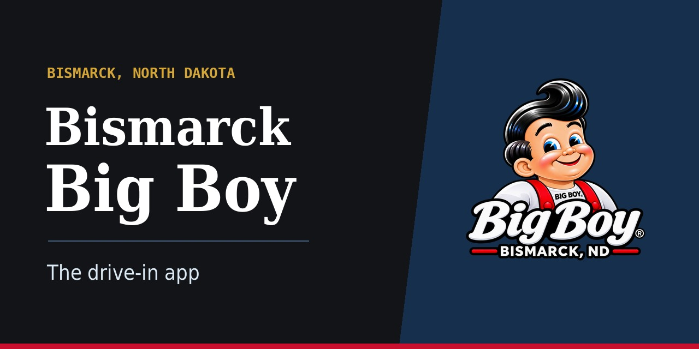

# Bismarck Big Boy



[](https://github.com/MidnightRaven9/bismarck-big-boy-app/actions/workflows/validate.yml) [](https://github.com/MidnightRaven9/bismarck-big-boy-app/releases/latest) [](LICENSE)

**[Open the web app](https://midnightraven9.github.io/bismarck-big-boy-app/)** · **[Download for Android](https://github.com/MidnightRaven9/bismarck-big-boy-app/releases/latest)** · **[Run locally](#getting-started)**

The pocket menu for [Bismarck Big Boy](https://www.bismarckbigboy.com/), the drive-in at 2511 E Main Ave in Bismarck, North Dakota. Check whether the restaurant is open, look up a Flying Style Pizza Burger, or head straight to pickup ordering.

The app’s *Big Boy After Dark* design pairs the restaurant’s red, white, and blue with a near-black canvas. The Info screen keeps the drive-in’s history alongside practical details, including the original newspaper clipping and the owner’s message.

## A look inside

| Home | Menu |
| --- | --- |
|  |  |

More views from the app · [Favorites](assets/screenshots/3-favorites.png) · [Rewards](assets/screenshots/4-rewards.png) · [Info](assets/screenshots/5-info.png) · [Delivery](assets/screenshots/6-delivery.png) · [History exhibit](assets/screenshots/7-history.png)

## What you can do

- **Plan a visit.** Check hours and open status in Bismarck time, get directions, or call the restaurant.
- **Find your usual.** Search and filter the photo menu, compare sizes and prices, and save favorites on your device.
- **Order or earn rewards.** Open pickup, delivery, Toast loyalty, eGift cards, or the Big Boy shop through their linked services.
- **Browse offline after a successful visit.** The service worker caches the app shell, menu, and hours. Live services such as ordering and maps require a connection.

## Install

| Device | How to install |
| --- | --- |
| **Android · Chrome** | Open the [web app](https://midnightraven9.github.io/bismarck-big-boy-app/) and choose **Install app** or **Add to Home screen** from Chrome’s menu. |
| **Android · APK** | Download the `.apk` from [GitHub Releases](https://github.com/MidnightRaven9/bismarck-big-boy-app/releases/latest). Open it on your phone and allow installs from that browser or file manager if Android prompts you. The APK opens the hosted app through a Trusted Web Activity. |
| **iPhone · Safari** | Open the [web app](https://midnightraven9.github.io/bismarck-big-boy-app/) in Safari and choose **Share → Add to Home Screen**. |

## Getting started

The app runs as static HTML, CSS, and JavaScript. Python is used here to serve the files locally. Node is needed for the test tooling.

```bash
git clone https://github.com/MidnightRaven9/bismarck-big-boy-app.git
cd bismarck-big-boy-app
python3 -m http.server 8000 --bind 127.0.0.1
```

Open [localhost:8000](http://localhost:8000/).

## Project layout

| Path | Role |
| --- | --- |
| [`index.html`](index.html), [`styles.css`](styles.css) | App shell, screen markup, and responsive styles |
| [`app.js`](app.js), [`core.js`](core.js), [`startup.js`](startup.js) | Rendering and navigation, business rules and validation, and splash readiness |
| [`menu.json`](menu.json), [`hours_overrides.json`](hours_overrides.json), [`facebook_deals.json`](facebook_deals.json) | Menu, special hours, and deals |
| [`manifest.webmanifest`](manifest.webmanifest), [`sw.js`](sw.js) | PWA installation and offline caching |
| [`tests/`](tests), [`scripts/`](scripts) | Node and Playwright tests, screenshots, and Android packaging |

## Checks and releases

Use Node 20 or later, Python 3, and Playwright’s Chromium.

```bash
npm ci
npx playwright install chromium
npm run test:all
python3 tests/android_splash_test.py
```

The [validation workflow](https://github.com/MidnightRaven9/bismarck-big-boy-app/actions/workflows/validate.yml) runs syntax, data, unit, packaging, and browser checks. GitHub Pages serves `main`. The [Android and deals workflow](https://github.com/MidnightRaven9/bismarck-big-boy-app/actions/workflows/auto-package.yml) validates changes before packaging or updating deal data. See the [maintainer guide](docs/maintainer-guide.md) for signing, release, and screenshot procedures.

## Contributing and security

Read the [contribution guide](CONTRIBUTING.md) before opening a pull request. Use [GitHub Issues](https://github.com/MidnightRaven9/bismarck-big-boy-app/issues) for app bugs and feature requests. Use the private channel in the [security policy](SECURITY.md) for vulnerabilities. The [changelog](CHANGELOG.md) records project updates.

## License and credits

The repository’s software is distributed under the [MIT License](LICENSE). Restaurant information, branding, and photography are credited to [Bismarck Big Boy](https://www.bismarckbigboy.com/). Maintained by [MidnightRaven9](https://github.com/MidnightRaven9).
